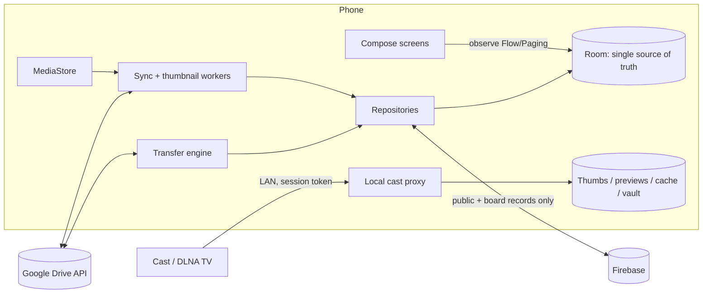

# PhotoXTPro — Master Build Prompt (v2)

> **What this is.** This is a complete, phase-by-phase spec for an AI coding agent (Claude Code, Codex, Gemini CLI, Cursor and similar) to build **PhotoXTPro**. PhotoXTPro is an Android gallery that does everything Samsung Gallery does, and does it better. It also turns Google Drive folders into streamed albums, lets you share from private to public, and hosts public media boards.
>
> **How to use it.** Keep this file in the repo root. Start every build session with:
>
> ```text
> Read photoxtpro-build-prompt.md completely, then AGENTS.md and memory.md.
> Implement Phase <N> only, following §0. Stop when every "Done when" item
> of Phase <N> passes, then report what you built, what you skipped and why.
> ```
>
> **Editions.** PhotoXTPro is the full edition: everything in PhotoXT plus public media boards (§4.16). The PhotoXT edition, without boards, is specified in `photoxt-build-prompt.md`. Both files use the same section and phase numbers. Recommended: one codebase with two Gradle product flavors, `standard` (PhotoXT) and `pro` (PhotoXTPro). Build PhotoXT first; the `pro` flavor then adds only the board parts: §4.16, the board items of Phase 12, and their security rules and tests.
>
> The original one-paragraph prompt is kept word for word in Appendix B. Appendix A maps each request in it to the section and phase that cover it.

---

## 0. Rules for the AI builder

1. **One phase per session.** Never start Phase N+1 until every *Done when* item of Phase N passes on a real build. `main` builds and passes tests after every commit.
2. **Plan before code.** At the start of a phase, restate its scope in 10 lines or fewer, list the modules and files you will touch, and name the checks that will prove it works.
3. **Reuse before you write.** Order of preference: code already in this repo → Android platform / Jetpack → the approved libraries in §5.1 → the minimum new code. Ask before adding any dependency that is not in §5.1.
4. **Never lose user data.** A delete goes to Trash first. A move (cut) deletes its source only after the copy is verified (size + MD5). Long operations are persisted, idempotent and resumable. Every destructive action offers Undo.
5. **Respect the data boundary (§5.7).** Drive file content, Drive metadata and OAuth tokens never leave the device. The backend never calls the Drive API. Never log tokens, file names or locations.
6. **Test what can break.** Each non-trivial unit (sync, cache eviction, transfer engine, conflict handling, share-permission mapping, edit-recipe rendering) ships with at least one runnable test. Prefer fakes (fake clock, fake Drive server) over mocks.
7. **When the spec is ambiguous,** pick the simplest option consistent with it, record the choice in `memory.md`, and continue. Stop and ask only when a choice is irreversible, costs money, or touches security or privacy.
8. **Workspace rules.** Record durable decisions in `memory.md`, log the session in `.session/`, and update the README status line.
9. **Kotlin/Compose hygiene.** Use immutable UI state per screen (`StateFlow` + `collectAsStateWithLifecycle`) and unidirectional data flow. No I/O on the main thread, no `GlobalScope`, no `!!`. Give lazy-list items stable keys, give every screen-level composable a preview, and keep all strings in resources so the app is i18n- and RTL-ready.
10. **QA devices.** Test on a Samsung Galaxy running One UI 8+, a Pixel running Android 17, a low-end Android 11 phone, and a foldable or tablet emulator.

---

## 1. Product

**Vision.** PhotoXTPro is one fast, private gallery for everything you own. Photos and videos on the phone and in chosen Google Drive folders are browsed as if they were local. It has Samsung-class editing, collages and casting, and sharing that scales from "just me" to "anyone on the internet".

**What makes it better than a Samsung Gallery replica:**

- Google Drive folders are first-class albums: streamed, with on-device thumbnails and a 30-day smart cache.
- One timeline across the phone and several Google accounts.
- Cut, copy and paste between phone and Drive. Drive-to-Drive copies and moves run server-side, so nothing is re-downloaded.
- Each album has its own visibility: Private → Shared (people, groups) → Link → Public. Public media boards sit on top.
- Pins, bookmark collections and a viewing history with resume points.
- Zoom lock and side-by-side compare for picking the best shot of a burst.
- Casting to Google Cast and DLNA TVs, including private Drive videos.

**Users.** v1 is for Robin plus family and friends (up to 100 Google accounts). A public Play Store release comes later (Phase 15, §9).

**Principles:** offline-first · private by default · never lose data · fast (budgets in §5.8) · one-handed reach (One UI style) · accessible.

---

## 2. Decisions already made

| Topic | Decision | Why |
|---|---|---|
| Platform | Native Android, Kotlin 2.x, Jetpack Compose | Best scrolling performance; full access to MediaStore, Media3, Google Cast and ML Kit |
| SDK levels | minSdk 30 (Android 11); targetSdk and compileSdk 37 (Android 17, stable since June 2026) | API 30 adds MediaStore trash/favorite/write requests and generation-based change tracking. Since 31 Aug 2026, Google Play requires new apps and updates to target API 36 or higher. |
| Audience | Private first (up to 100 Google accounts), kept Play Store-ready | Chosen by the owner |
| Google sign-in | Credential Manager (Sign in with Google) for identity, `AuthorizationClient` for Drive scopes | Legacy Google Sign-In for Android is deprecated |
| Drive scopes | `drive.readonly` when the first folder is added; upgrade to `drive` the first time the user writes (move, delete, rename, share, overwrite); `drive.appdata` for settings sync | `drive.file` + Google Picker does not let the app list a picked folder's contents (in testing, the listing comes back empty, and Google's docs don't promise child access). Folder albums therefore need a restricted scope. Re-test in the Phase 3 spike. |
| Backend | Firebase: Auth, Firestore, Cloud Functions, Hosting, Storage (published renditions only), FCM, App Check | Fits Google sign-in; the free tier covers private use |
| Region | Firestore and Functions in `asia-south1` (Mumbai) | Closest to the first users |
| Data boundary | Drive data and tokens stay on the device (§5.7) | Storing or transmitting restricted-scope data on servers triggers Google's annual security assessment |
| Share links | Android App Links on the Firebase Hosting domain | Firebase Dynamic Links shut down in August 2025 |
| Design | Material 3 (Compose Material3 1.4 stable; adopt Expressive components as they graduate to stable) with One UI-style reachability | Familiar to Samsung users, native on Pixels |

**Google Cloud setup for private use.** Use an OAuth consent screen of type External.

- **Testing status:** only listed test users (up to 100) can sign in, and their Drive grants expire after 7 days. The app must handle re-consent gracefully: a non-blocking "Reconnect Google Drive" banner, never a crash.
- **In production without verification:** users see an "unverified app" warning and the project is capped at 100 users, but grants don't expire weekly.
- **Before a public launch:** complete restricted-scope OAuth verification (Phase 15).

---

## 3. Glossary — exact meanings

- **Source** — where the bytes live. `DEVICE` is MediaStore. `DRIVE` is one Google account's Drive, including shared drives and items shared with the user. `REMOTE` is someone else's public album or board item, reached through the backend.
- **Album** — a named collection shown as a folder. Types:
  - **Device folder** — a folder on the phone.
  - **Drive folder** — one album per selected Drive folder.
  - **Virtual** — hand-picked items from any source; nothing is moved.
  - **Smart** — a saved rule, e.g. "videos longer than 1 min from 2025".
  - **Shared-with-me**, **Public** and **Board**.
- **Drive item states**
  - `THUMB_ONLY` — metadata and thumbnails on the device.
  - `CACHED` — the full file is on the device and expires.
  - `OFFLINE` — the full file is pinned and never expires.
  - When a cached file expires, the item returns to `THUMB_ONLY`.
- **Retention** — a cached full file is deleted 30 days after it was last *opened*. That is the default; the setting offers 7, 14, 30, 60 or 90 days, or never. Thumbnails and metadata never expire while the item exists.
- **Favorite** — a one-tap heart on your own media. It syncs to MediaStore `IS_FAVORITE` and to Drive `starred`.
- **Pin** — keeps an album or item at the top of its list. It can also pin the album to the home screen as a shortcut or widget.
- **Bookmark** — save-for-later on anything: your own media, shared or public items, or a moment in a video. Bookmarks go into named collections and can carry a note.
- **History** — a private, on-device log of what you viewed and how far you watched.
- **Visibility** — set per album or item:
  - `PRIVATE` (the default)
  - `SHARED` — specific people and groups
  - `LINK` — anyone with the link; not listed
  - `PUBLIC` — listed in Public Albums
- **Board** — a public or unlisted collection that other signed-in users can post to: an Image board, a Video board, or a Media board (both).
- **Stretch** — a display mode that fills the screen and ignores the aspect ratio, distorting on purpose. It is distinct from Fit, Fill (crop) and 1:1.

---

## 4. Feature specification

### 4.1 Navigation and screens

- **Bottom navigation, 5 tabs:** Pictures · Albums · Shared · Public · Library. The Shared tab's screen is titled **Shared Albums**; the Public tab's is titled **Public Albums**.
- **Larger screens:** from 600 dp width, use a navigation rail. On foldables and tablets, show list-detail (grid and viewer side by side) through Navigation 3 scenes.
- **Top of every main screen:** a large collapsing title. At rest the content starts in the lower half of the screen, One UI style. Below it sit a search field, the account avatar and an overflow menu.
- **Library tab:** Favorites, Pinned, Bookmarks, History, Videos, Recent, Places (map), People (opt-in), Things, Screenshots, Cleanup, Trash, Hidden, Vault, Offline, Transfers, Settings.
- **Shared Albums:** a segmented control for *With me* and *By me*, plus pending invites and recent activity.
- **Public Albums:** Discover (New, Trending, Following), Boards, My public albums and boards, and public search.
- **Multi-select everywhere:**
  - Start it by long-press or drag-select.
  - A bottom action bar offers Share, Cut, Copy, Add to album, Favorite, Delete and More.
  - Each date group has a select-all control, and the selection count shows in the title.
- **Sync status:** every Drive album shows a status chip: synced, syncing, offline or needs attention.
- **Deep links:** every album, item, board and share is addressable — `photoxtpro://` inside the app, App Links outside it.

### 4.2 Sources and albums

**Device**

- All MediaStore volumes are covered: internal storage and SD card.
- Each folder (bucket) is one album. Camera, Screenshots, Downloads and WhatsApp folders are recognised automatically.

**Google Drive**

- Multiple accounts are supported (personal + work).
- **Add Drive folder** opens an in-app Drive browser with My Drive, Shared with me, Shared drives, Starred and search.
- Each selected folder becomes one album, named after the folder. It can be renamed in-app without renaming it in Drive.
- **Subfolders** show as nested albums inside an album group by default. A per-album toggle, *Merge subfolders into this album*, flattens them.
- Drive shortcuts resolve to their targets. Google Docs and other non-media files are ignored.

**Formats**

- **Photos:** JPEG, PNG, WebP (incl. animated), GIF, HEIC/HEIF, AVIF, BMP, DNG/RAW (preview), Ultra HDR JPEG, Motion Photos (Google and Samsung) and 360° panoramas.
- **Videos:** MP4, MOV, MKV, WebM and 3GP.
- Codec support varies by device. When a codec is missing, show a clear "unsupported codec" state with an *Open with…* action.

**Album options**

- Cover: any item.
- Sort: date taken, date modified, name, size, or custom drag order.
- Visibility and storage: hide from Pictures, hide the album entirely, group albums, pin, make the whole album available offline, and set per-album visibility.
- List view: grid or list, pinned albums first, and a source badge on each (phone, Drive, shared, public).

**Pictures timeline**

- Merges all non-hidden albums from all sources, with a per-source toggle.
- Groups by day, month or year.
- Pinch changes density, Samsung style: year → month → day → 1–7 columns.
- A fast scroller shows a date bubble.
- Filter chips: All, Photos, Videos, Favorites, Device, Drive, Offline.
- Similar shots and bursts can collapse into a stack.

### 4.3 Thumbnails, scanning and change detection

**Google Drive — initial scan**

1. Call `changes.getStartPageToken` *before* scanning, so no change made during the scan is missed.
2. Walk the folder tree breadth-first with `files.list`:
   - `q: '<folderId>' in parents and trashed=false`
   - `pageSize=1000`, minimal `fields`
   - `supportsAllDrives=true`, `includeItemsFromAllDrives=true`
3. Store, per file:
   - `id`, `name`, `mimeType`, `size`, `md5Checksum`, `version`
   - `modifiedTime`, `createdTime`, `parents`, `starred`, `hasThumbnail`
   - `imageMediaMetadata`: width, height, rotation, time taken, location, camera
   - `videoMediaMetadata`: width, height, `durationMillis`

**Google Drive — thumbnails (the user's requirement)**

- Thumbnails are stored on the device in two sizes:
  - `grid` — about 384 px on the short edge, WebP
  - `preview` — about 1600 px on the long edge, WebP, created the first time the full image is opened
- For the grid size, use Drive's own `thumbnailLink`. Request about 512 px with an authorised request. This is a tiny download, and the full file is never needed. The link is short-lived, so refresh the file's metadata when it fails.
- If Drive has no usable thumbnail, fall back in this order:
  1. For JPEG, fetch only the first ~128 KB with an HTTP Range request and extract the embedded EXIF thumbnail.
  2. For video, run `MediaMetadataRetriever` on the authorised stream.
  3. Download the file and downscale it.
- Store a BlurHash/ThumbHash string in the DB for instant placeholders.
- Thumbnail work runs in a priority queue: items on screen first, then the rest of the album, then other albums. It pauses on metered networks or low battery, per settings.

**Google Drive — incremental sync**

- One Changes API feed covers every tracked folder of an account: `changes.list(pageToken, includeRemoved=true, …)`.
- Apply each change:
  - Trashed or removed → mark the item removed.
  - Parents moved into or out of a tracked tree → add it to, or remove it from, the album.
  - `md5Checksum` or `version` changed → invalidate both thumbnails and any cached full file, then regenerate.
  - Renamed → update the name.
- Save `newStartPageToken` in the same DB transaction as the applied changes.
- When a folder is renamed or moved in Drive, the album name and path follow, unless the user renamed the album in-app.

**Google Drive — when to sync**

- On app start or return to foreground (debounced to once per 30 s)
- On pull-to-refresh
- Every 6 h through a WorkManager job (network required, battery not low)
- After any write PhotoXTPro makes

**Google Drive — cleanup and lost access**

- **Orphans:** the thumbnails, previews and cached files of items removed in Drive are deleted after a 7-day grace period. Undoing the removal in Drive restores the item instantly.
- **Lost access** (folder deleted or unshared, or account removed): the album shows an "Unavailable" banner with *Relink* and *Remove*. Its thumbnails are kept until the user removes the album.

**Device**

- Index MediaStore incrementally with `MediaStore.getGeneration` and `GENERATION_MODIFIED`.
- Detect deletions with a cheap ID-set diff. Rescan fully when `MediaStore.getVersion` changes.
- A `ContentObserver` updates the UI live while the app is open.
- Device thumbnails come from `ContentResolver.loadThumbnail`, which the system already caches. Don't duplicate them on disk.

**Permissions UX**

- Request `READ_MEDIA_IMAGES` and `READ_MEDIA_VIDEO`, plus `ACCESS_MEDIA_LOCATION` for GPS data.
- Handle Android 14+ "selected photos only" access with a persistent banner.
- Offer the special *Media management* access (`MANAGE_MEDIA`, Android 12+), so trash, move and edit need no confirmation for every batch.
- PhotoXTPro qualifies for broad access under Play's Photo and Video Permissions policy as a gallery app. File the declaration in Play Console.

### 4.4 Streaming, downloads and the 30-day cache

- **Opening a Drive photo.**
  1. The placeholder shows instantly in this order: BlurHash → grid thumbnail → preview (if one exists).
  2. Meanwhile the full file streams in the background through `files.get?alt=media` (authorised; resumable via Range).
  3. The full image swaps in once decoded.
  - Huge images (over 24 MP, or over 4096 px on a side) use tiled, sub-sampled decoding.
- **Videos.**
  - Stream with Media3 ExoPlayer over OkHttp, sending the auth header and HTTP Range requests, so the user can seek anywhere without downloading the file.
  - Media3 `SimpleCache` (LRU, size-capped) keeps the streamed segments.
  - *Download for offline* stores the full file.
- **Prefetch.**
  - In the viewer, the full files of the next and previous 2 items are prefetched (Wi-Fi only by default).
  - *Make album available offline* downloads every item and pins them.
- **Retention (the 1-month rule).**
  - A daily WorkManager job deletes cached full files that haven't been opened for 30 days (configurable), unless they are pinned offline. Each such item returns to `THUMB_ONLY`.
  - A storage cap (default 5 GB, configurable) evicts the least recently opened files first when exceeded.
  - Previews live in their own capped LRU (default 1 GB).
  - The video segment cache follows the same retention, using each span's last-touch time.
- **Data saver.** On mobile data, only the preview size opens until the user taps *Load original*. Setting: Always original / Wi-Fi only / Ask.
- **Storage screen.**
  - Per account and per album: thumbnails, previews, cached originals, offline pins and video cache.
  - Actions: *Free up now* and *Clear cache for this album*.
- **Location.** Files live in app-internal `filesDir`, not `cacheDir`, so the system doesn't purge them early. PhotoXTPro's own eviction keeps them bounded.

### 4.5 Viewer: pan, zoom, stretch and gestures

**Navigation**

- A horizontal pager moves through the current album or timeline order.
- Opening from the grid uses a shared-element transition. Swipe down closes the viewer, and predictive back is supported.

**Zoom and pan**

- Pinch to zoom, up to 4× beyond 1:1 pixels.
- Double-tap cycles Fit → Fill → 1:1 at the tapped point.
- One-finger zoom: double-tap and drag.
- Fling with momentum and edge resistance.
- Two-finger rotate (view only, temporary).
- On DeX and tablets: mouse wheel, Ctrl+scroll and keyboard.

**Display modes**

- Fit, Fill (crop), **Stretch** (ignores aspect ratio), Fit width, Fit height, 1:1.
- The mode is kept for the session and remembered for slideshows and casting.

**Comparing photos**

- **Zoom lock** keeps the zoom level and position while you swipe between photos, so you can compare sharpness across a burst.
- **Compare** shows two photos side by side, or with a split slider, with zoom and pan in sync. It is also used for before/after edits.

**Details sheet (swipe up)**

- Date, size and resolution.
- Camera, lens and exposure (EXIF).
- Location with a mini map.
- Source: device path, or Drive owner, folder and last modified.
- Sharing status, tags and OCR text.
- Editing date/time and location: written into device files; for Drive files, stored as PhotoXTPro overrides.

**Special formats**

- Motion photos (play on long-press or automatically), Ultra HDR/HDR display (window HDR colour mode), animated GIF/WebP, a 360° panorama viewer, RAW preview, and expandable burst stacks.

**Slideshow**

- Interval, transitions (fade, slide, Ken Burns), shuffle, loop and optional music from a device audio file.
- Works while casting.

**Quick actions**

- Edit, Share, Favorite, Pin, Bookmark, Cast, Delete.
- Set as wallpaper or contact photo, Copy to clipboard, Open with, Print, Info.

### 4.6 Video player

Built on Media3 ExoPlayer with a Compose UI.

- **Gestures:** horizontal swipe to seek; vertical swipe on the left for brightness and on the right for volume; double-tap for ±10 s; pinch to zoom into the video.
- **Playback:** speed 0.25–4×, A-B repeat and loop, frame-by-frame step, rotation lock.
- **Display:** aspect modes Fit / Fill / Stretch / 16:9 / 4:3, and HDR playback.
- **Capture:** save the current frame as a photo.
- **Modes:** picture-in-picture, and optional background audio through a MediaSession.
- **Subtitles and audio:** side-loads a `.srt` or `.vtt` file with the same name in the same folder, Drive included. Audio tracks can be selected.
- **Continuity:** resumes from History and hands off to Cast.

### 4.7 File operations: cut, copy, paste and trash

**Clipboard**

- Select items, choose Cut or Copy, and a persistent *Paste N items here* bar appears while you browse.
- Paste into any album or folder, on the device or in Drive.
- The clipboard survives app restarts until it is pasted or cleared.
- *Copy to system clipboard* lets you paste a single image into another app.

**Operation matrix** (implement exactly)

| From → To | Copy | Cut (move) |
|---|---|---|
| Device → Device | Stream copy into the target folder via MediaStore | Update `RELATIVE_PATH` (same volume); otherwise copy → verify → trash |
| Device → Drive | Resumable upload | Upload → verify MD5 → trash the device original |
| Drive → Device | Download into the target folder via MediaStore | Download → verify → trash in Drive |
| Drive → Drive, same account | `files.copy` (server-side, no download) | `files.update` add/remove parents (instant) |
| Drive → Drive, other account | Stream download → upload | Same, then verify → trash the source |

**Albums and folders**

- Albums and folders can be cut, copied and pasted (recursively), renamed, and created.
- *New album* creates a new folder: on the device or in Drive, depending on where you are.

**Conflicts.** Keep both (auto-suffix " (1)"), Replace or Skip, with *Apply to all*.

**Transfer engine**

- A persistent job queue in Room, with a state for each item.
- Resumable: Drive resumable uploads and Range downloads.
- Verifies size and MD5, and retries with exponential backoff.
- Shows a progress notification and a *Transfers* screen with pause, resume, cancel and retry.
- Large user-initiated transfers use *user-initiated data transfer jobs* (Android 14+). Since Android 15, `dataSync` foreground services are limited to 6 h per 24 h. Everything else uses WorkManager.

**Undo.** Every move and delete shows an Undo snackbar, and the reverse operation is recorded.

**Trash**

- One Trash view covers both sources: the device's MediaStore trash and the Drive trash. Each auto-deletes after 30 days.
- Actions: restore, delete forever, empty.
- Drive files you don't own can't be trashed, so offer *Remove from this album* instead.

**Batch tools.** Rename with patterns (`{date}_{n}`), resize/compress, convert formats (e.g. HEIC → JPEG for compatibility), strip metadata, and export the selection as a PDF (Android `PdfDocument`).

### 4.8 Organize: favorites, pins, bookmarks, hidden, vault

**Favorites**

- A heart in the grid and the viewer.
- Two-way sync with MediaStore `IS_FAVORITE` and Drive `starred`.
- Starring a Drive file is a write, so the first favorite on a Drive item triggers the `drive` scope upgrade (§2).

**Pins**

- Pin albums (to the top of Albums), items (to the top of their album), boards and shared albums. Reorder pins by dragging.
- *Pin to home screen* adds a pinned shortcut or a Glance photo widget showing that album.

**Bookmarks**

- Bookmark any item, album or board, including other people's shared or public ones.
- Collections are named ("Ideas", "To print") and can carry notes.
- Video timestamps: "bookmark this moment".
- A bookmark to a remote item keeps a cached thumbnail, and shows "No longer available" once access is revoked.

**Hidden.** Hide items and albums from Pictures and search. The Hidden list opens behind biometric unlock.

**Vault**

- Moves items into an encrypted on-device vault: Tink AEAD, with the key in Android Keystore.
- Biometric unlock; screenshots blocked.
- Vault items are excluded from history, search, backup and casting.

**Album structure**

- **Album groups.**
- **Smart albums**, built from rules: type, date range, source, album, place, camera, size, favorite, label.
- **Virtual albums:** add items from anywhere without moving files.

**Settings sync**

- Album list, pins, bookmarks, share groups, edit presets, and history (if enabled) are saved in the user's own Drive app-data folder (`drive.appdata`, a non-sensitive scope).
- A reinstall restores everything without any PhotoXTPro server.

### 4.9 History

- **What it logs:** item views (time, source, album context) and video progress.
- **What it powers:** *Recently viewed* and *Continue watching* rows, and a per-item "viewed N times".
- **Controls:**
  - Pause history (incognito).
  - Clear everything or a date range.
  - Auto-delete after 3 or 12 months, or never. Default: 12 months.
  - Hidden and Vault items are never logged.
- **Where it lives:** history stays on the device. It syncs to the user's Drive app-data folder only when settings sync is on.

### 4.10 Image editor

Editing is non-destructive. Every edit is an `EditRecipe`: an ordered list of operations with their parameters, stored as JSON. One GPU pipeline renders it — a screen-sized proxy for live preview, and full resolution on export (tiled for very large images).

**Transform**

- Crop: free, original, 1:1, 4:5, 3:4, 9:16, 16:9, custom.
- Rotate 90°, flip, and straighten ±45° with a grid.
- Perspective/keystone: horizontal, vertical, 4-corner.

**Light and colour**

- Auto-enhance, exposure, brightness, contrast.
- Highlights, shadows, whites, blacks.
- Saturation, vibrance, temperature, tint, hue, HSL per colour.
- Curves (RGB and per channel).
- Sharpen, clarity, dehaze, vignette, grain, fade.

**Filters**

- Built-in looks with an intensity slider.
- Import `.cube` 3D LUTs, and save your own presets.

**Selective**

- Brush, linear and radial masks.
- Automatic subject and background masks via ML Kit Subject Segmentation.

**Retouch**

- Object/spot eraser using an on-device inpainting model (LiteRT, downloaded on demand).
- Red-eye, light skin smoothing, background blur.

**Cut-out**

- Remove or replace the background.
- *Lift subject* to a transparent PNG or sticker, or copy it to the clipboard.

**Redact**

- Blur, pixelate, or a solid bar.
- One tap auto-detects faces, text and number plates.

**Add**

- Text: fonts including Devanagari; size, colour, outline, shadow, background, alignment.
- Stickers and emoji, shapes and arrows.
- Freehand drawing: pen, marker, highlighter, eraser, with stylus pressure.
- Frames and borders.
- Watermark: text or logo, with a tiled option.
- Colour picker: from anywhere on screen with the Android 17 EyeDropper API; inside the image on older versions.

**Output**

- *Save* overwrites but is always revertible; *Save as copy* creates a new file.
- Resize by pixels, percentage or preset; target a file size ("under 500 KB").
- Format (JPEG/PNG/WebP/HEIC/AVIF) and quality; keep or strip metadata.

**Revert to original — any time**

- Device files: the original is kept in app storage.
- Drive files: the edit is saved as a new Drive revision, and the original revision is marked `keepForever`. Drive allows that on up to 200 revisions per file.

**Productivity**

- Compare: press and hold to see the original.
- Undo/redo with a history list; reset per tool.
- *Copy edits* → *Paste edits* onto other photos, or batch-apply a recipe to a selection.

**Optional cloud AI** (later; off by default; opt-in per image)

- Generative fill/expand and "describe an edit", via Firebase AI Logic with a current Gemini image model.
- Before anything is sent, show what will leave the device and what it may cost. Never for Vault items.
- Using it on Drive photos is an open decision (§9).

### 4.11 Collage studio

**Input.** Pick 2–20 items from any source. Drive items are downloaded as needed.

**Modes**

- **Grid templates:** 100+ layouts for 2–20 photos, filtered by count.
- **Smart layout:** builds a layout from the photos' aspect ratios and detected faces, so no face is cropped.
- **Freeform/scrapbook:** free position, rotation, scale and layer order.
- **Stitch:** a vertical or horizontal long image, e.g. from screenshots.
- **Shapes:** heart, circle, hexagon, letters.
- **Story/Status:** 9:16 templates.
- **Before/After.**

**Canvas**

- Aspect presets: 1:1, 4:5, 3:4, 9:16, 16:9, 3:2, A4/Letter at 300 DPI, or custom pixels.
- Spacing, outer margin, corner radius, border width and colour.
- Background: solid, gradient, blurred photo, pattern, or transparent.

**Cells**

- Drag to swap; pan, zoom, rotate and flip inside a cell; replace a photo.
- Per-cell filter and adjustments, using the editor pipeline.
- Drag dividers to resize cells.

**Extras.** Text, stickers, frames, snapping guides, a layers panel, undo/redo. Work auto-saves as a re-editable draft (project JSON that references the source items).

**Export.** JPEG, PNG or WebP with a quality setting, up to an 8K long edge (memory-checked). Save to a chosen device album or Drive folder; the default is the album of the first photo.

**Delete sources after export (the user's request)**

- A checkbox in the export dialog, off by default.
- The dialog shows how many sources are on the device and how many are in Drive.
- Sources move to Trash (recoverable for 30 days) only after the collage file has been written and verified to decode. An Undo snackbar follows.
- Drive sources need the Drive write scope.

**Later phase.** Video collage: clips in cells, built on a Media3 composition.

### 4.12 Video tools

Built on Media3 Transformer.

- **Edit:** trim, split, merge clips, crop/rotate, change speed.
- **Audio:** mute, replace, or adjust volume.
- **Look:** filters and adjustments (the same looks as photos), text and sticker overlays.
- **Extract:** grab a frame as a photo.
- **Export:** create a GIF/WebP from a clip or from selected photos. Compression presets: "WhatsApp-friendly 720p" and "Email under 25 MB". HDR → SDR export.
- **Behaviour:** a progress notification while exporting; always saves as a copy.

### 4.13 Casting

**Google Cast**

- Works with Chromecast, Android TV/Google TV, and TVs with Chromecast built in.
- Uses the Cast SDK with the Default Media Receiver, and the Media3 Cast extension for video.

**Local streaming proxy**

Drive files need the user's token, so PhotoXTPro runs a small streaming proxy on the phone while casting. The proxy:

- binds to the Wi-Fi interface only, on a random port;
- uses per-session random URL tokens;
- serves only the queued items;
- supports HTTP Range, so video can seek;
- stops when the cast session ends.

Cached and device files are served from local storage instead of being fetched from Drive.

**Remote mode**

- The TV shows the photo, video or slideshow while the phone shows the album.
- Swipe on the phone and the TV moves to the next item.
- Play, pause, seek and volume controls; queue a whole album as a slideshow.
- The display mode (Fit, Fill or Stretch) applies on the TV.

**Other routes**

- DLNA/UPnP renderers (many Samsung, LG and Sony TVs) through a UPnP control point: Phase 10b.
- A *Mirror screen* shortcut opens the system cast panel.
- When the TV can't reach the phone (guest or isolated Wi-Fi), say so clearly.

### 4.14 Sharing (WhatsApp and every other app)

PhotoXTPro shows its own **Share as…** sheet first, then the Android Sharesheet. The four modes:

1. **Thumbnail + link** — the default for Drive items and albums, and the user's original request.
   - It sends one image: the item's preview, or, for albums and multiple items, an auto-generated *album card* (2×2 cover mosaic + title + item count).
   - The link goes in as caption text (`EXTRA_STREAM` + `EXTRA_TEXT`), so WhatsApp shows the picture with the link under it.
   - Send one image, not several. Captions on multi-image shares are unreliable across apps.
2. **Link with preview card** — the link only. WhatsApp, Telegram and Slack build the card from the landing page's Open Graph tags.
   - Only for PUBLIC content, whose renditions are hosted (§4.15). Drive-native SHARED and LINK links can't carry per-item cards, because the server never sees the Drive ID (§5.7). For those, use mode 1.
   - The card image must be 1200×630, at most ~250 KB, over HTTPS; WhatsApp silently drops larger images.
3. **Original files** — full quality, downloaded first if needed. Suggest sending as a WhatsApp *document* to avoid recompression.
4. **Optimised** — resized photos and 720p video, for chats on slow data.

**Rules around sharing**

- **Check the audience first.** If the recipients can't open the link yet, PhotoXTPro asks to change visibility (e.g. Private → Link) and shows exactly who will be able to see it.
- **Privacy defaults.** Strip GPS location (on by default, with a toggle), and optionally all EXIF. Never include Hidden or Vault items in a multi-share without confirmation.
- **PhotoXTPro as a share target.** *Save to PhotoXTPro* lets any app send media into a chosen device album or Drive folder.
- **Where links open.** In the PhotoXTPro app via verified App Links. Without the app, they open the Drive web view (SHARED or LINK) or the hosted page (PUBLIC).

### 4.15 Visibility levels, Shared Albums and Public Albums

Every album and item starts **Private**.

| Level | Who can see it | How it works in v1 |
|---|---|---|
| Private | Only you | Nothing leaves your device or your Drive |
| Shared | Chosen people and groups | Drive permissions on the folder or files. Viewer = Drive reader. Contributor = Drive writer (warn: writers can also rename or remove files). Optional expiry date through Drive's permission expiry. |
| Link | Anyone with the link; not listed | Drive "anyone with the link" (reader) on the folder or files. Optional auto-revoke date, enforced by an on-device job. |
| Public | Everyone; listed in Public Albums | You publish web renditions to PhotoXTPro hosting; originals stay in your Drive (§5.7) |

**Choosing people**

- Android 17+: the system Contact Picker (`ACTION_PICK_CONTACTS`). Request only email/phone, allow multi-select, and read the session URI immediately.
- Older Android: `ACTION_PICK`, one contact at a time.
- Or type an email directly. Google Groups addresses work too.
- **Contact lists:** saved share groups (e.g. "Family", "Work"), reusable with one tap.
- Contacts without a Google account (phone number only) get a Link share instead.

**Shared Albums**

- **With me:** folders and files shared with you in Drive (`sharedWithMe`).
  - PhotoXTPro shares are highlighted; they are tagged with Drive `appProperties`.
  - Public albums you have accepted appear here too.
  - Add any of them to Albums with one tap; new items get badges.
- **By me:** everything you have shared, with audience, level and date.
  - One-tap **Revoke**.
  - Edit members and roles.

**Public Albums**

- Discover public albums and boards: New, Trending, Following.
- Search by title or tag.
- Follow, bookmark or report.

**Notifications**

- Each type can be switched off: invite received (via FCM; the payload carries only names and titles, never Drive IDs), new items in followed or shared albums, board activity.

### 4.16 Media boards

**Basics**

- Types: Image board, Video board, Media board (both).
- Visibility: Public (listed) or Link (unlisted).
- Contribution modes: owner only, approved members, or any signed-in PhotoXTPro user. An approval queue is optional.

**Posting**

- A contributor picks items from any source, with an optional caption.
- PhotoXTPro uploads web renditions only; originals never upload.
  - Photos: up to 2048 px, WebP/AVIF, plus a 400 px thumbnail.
  - Video: 720p H.264, up to 60 s or 50 MB (configurable).

**Viewing.** Masonry grid and full-screen viewer, sorted by New or Top. Likes are on; comments are off by default and the owner can enable them. Anyone can follow a board.

**Safety** — required by Google Play's user-generated-content policy (and its Child Safety Standards if the app is listed as Social):

- Terms and community rules that explicitly prohibit child sexual abuse and exploitation.
- Report an item or user in two taps; block users.
- Owner tools: remove, pin, ban, close the board.
- Reports on public albums, and reports a board owner escalates, go to an admin review queue for the app owner.
- Rate limits and file-size caps.
- Automated image screening on upload (Cloud Vision SafeSearch in a Cloud Function), with quarantine.
- A designated safety contact.

**Profile.** A public display name and avatar, used only on public features. Everything else stays private.

**Account deletion.** In-app and on the web — a Play requirement for apps with accounts. Deletes the profile, boards and hosted renditions.

### 4.17 Search, AI and memories

**Search**

The search bar suggests as you type. It matches:

- File name, date ("June 2024", "last week"), place, album, type, camera, size.
- Text inside images: on-device OCR for Latin and Devanagari scripts.
- Things: ML Kit image labels.
- Captions: ML Kit GenAI Image Description on devices with Gemini Nano; skipped elsewhere.
- People: opt-in, on-device face grouping (later phase).

**Index.** A SQLite FTS5 table, fed by a background indexing job (charging and idle by default). Everything stays on the device.

**Places.** A map with clustered pins. GPS comes from EXIF or from Drive's `imageMediaMetadata.location`. Reverse-geocoding results are cached on the device.

**Memories**

- "On this day".
- Trip and event stories, built automatically from date and place clusters.
- A year in review.
- Export any story as a video with music (Media3 Transformer).

**Cleanup**

- Exact duplicates: Drive provides MD5 for free; device MD5 is computed lazily.
- Near-duplicates and bursts: perceptual hash on grid thumbnails, with a "keep best" suggestion (sharpness, eyes open).
- Also: blurry photos, large videos, old screenshots, WhatsApp forwards.
- Every cleanup delete goes to Trash.

**Extras.** QR and barcode detection on photos (open the link, copy the text). *Scan document* saves into an album (ML Kit Document Scanner).

### 4.18 Backup (optional)

- Auto-upload chosen device folders (e.g. Camera) to a chosen Drive folder.
- Options: Wi-Fi only, charging only.
- Skips duplicates by MD5, and uploads are resumable.
- Never deletes originals unless the user runs *Free up device space*. Even then it removes only items verified in Drive, after a confirmation, and via Trash.

### 4.19 Security and privacy

- **Tokens.** Google Play services holds the grants. PhotoXTPro keeps access tokens in memory only and never logs them.
- **App lock.**
  - An optional biometric or PIN lock, on top of Android 17's per-app lock.
  - Hidden and Vault always need unlocking.
  - `FLAG_SECURE` on Vault screens.
- **Backend.**
  - Firestore security rules: deny by default, owner-only writes, validate size and shape.
  - App Check with Play Integrity on every backend call.
  - Rate limits in Cloud Functions; unguessable IDs (at least 128-bit).
- **Casting proxy.** Wi-Fi interface only, random tokens, auto-stop (§4.13).
- **Policies.** A privacy policy and the Play Data safety form. No ads. Analytics and crash reporting are opt-in.
- **Do not use** `androidx.security:security-crypto` — it is deprecated. Use Tink with Android Keystore.

### 4.20 Platform polish

- **Large screens.**
  - List-detail layouts, a navigation rail, keyboard shortcuts, and mouse hover.
  - Drag photos out to other apps, and drop them into PhotoXTPro to import.
  - Every orientation and window size must work: Android 17 ignores orientation and resizability locks on large screens.
- **Widgets (Glance).** A photo frame (album, shuffle, interval) and *On this day*.
- **Screensaver.** An album slideshow while charging, through DreamService, so an old tablet becomes a photo frame.
- **Accessibility.**
  - TalkBack labels built from captions, labels, date and place.
  - 48 dp touch targets; text scaling up to 200 %.
  - Contrast-safe themes, reduce-motion support, and switch access.
- **Theming.** Light, dark and AMOLED black; dynamic colour; a choice of accent.
- **Languages.** English first, with every string in resources. Devanagari fonts are available for editor and collage text.

### 4.21 Settings (minimum set)

- **Accounts and storage:** Google accounts and Drive folders; sync interval and mobile-data rules; cache retention days, cache cap, preview cap and prefetch count; data saver.
- **Sharing and privacy:** default share mode; strip location; history on/off and auto-delete; app lock.
- **Other:** casting defaults; backup rules; settings sync; notifications per type; theme; about and licences; delete account.

---

## 5. Architecture

### 5.1 Stack and approved libraries

Use the latest stable version of each at build time, pinned in `libs.versions.toml`.

| Area | Libraries |
|---|---|
| Language | Kotlin 2.x (K2), Coroutines + Flow, kotlinx.serialization, KSP |
| UI | Compose BOM, Material 3 + material3-adaptive, Navigation 3, Lifecycle/ViewModel, Splash Screen, Baseline Profiles |
| DI | Hilt |
| Data | Room (incl. FTS5), Paging 3, DataStore (Proto), WorkManager |
| Network | OkHttp + Retrofit. Drive REST v3 as a thin hand-written interface; not the heavy `google-api-services-drive` client. |
| Images | Coil 3 (+ video frames), Telephoto (zoom + sub-sampling), AndroidX ExifInterface, a small BlurHash util |
| Media | Media3: ExoPlayer, OkHttp data source, UI-Compose, Session, Transformer, Effect, Cast |
| Google | Credential Manager + Google ID, Play services Auth (`AuthorizationClient`), Cast framework, Maps Compose |
| ML | ML Kit text recognition (Latin + Devanagari), image labeling, face detection, subject segmentation, barcode scanning, document scanner; ML Kit GenAI Image Description; LiteRT for the inpainting model |
| Backend | Firebase Auth, Firestore, Functions (TypeScript), Hosting, Storage, Messaging, App Check, Crashlytics (opt-in), AI Logic (optional) |
| Security | Tink + Android Keystore, androidx.biometric |
| Casting proxy | Ktor server (CIO engine) with partial-content support |
| Widgets | Glance |
| Quality | JUnit, kotlin-test, Turbine, MockWebServer, Robolectric (only where needed), Compose UI tests, Roborazzi screenshots, Macrobenchmark; Android Lint, detekt, ktlint (Spotless); GitHub Actions CI; Firebase Emulator Suite for rules and functions tests |

### 5.2 Module map

Create each module when its phase starts, not before.

```text
app/                 entry point, Navigation 3 graph, DI root, App Links
build-logic/         Gradle convention plugins
core/model           pure Kotlin domain types
core/common          dispatchers, Result types, Clock, redacting logger
core/database        Room entities, DAOs, migrations, FTS
core/datastore       settings (Proto DataStore)
core/auth            Credential Manager, AuthorizationClient, token provider, scope upgrades
core/drive           Drive REST: files, changes, permissions, revisions, about
core/media           MediaStore indexer, thumbnail store, cache manager, EXIF, motion photo, decoders
core/sync            sync engine + workers
core/transfer        copy/move/upload/download queue
core/render          GPU image pipeline (editor, collage, export)
core/designsystem    theme, components, icons, motion
core/ui              shared composables (media grid, selection, tiles, empty/error states)
core/backend         Firebase repositories (shares, boards, profiles)
core/ml              ML Kit / AICore wrappers, indexing job
feature/*            timeline, albums, viewer, player, editor, collage, video, cast, share,
                     shared, public, boards, search, library, settings, onboarding
backend/             firestore.rules, storage.rules, functions/, hosting/ (landing pages)
benchmark/, baselineprofile/
```

### 5.3 Layers and data flow

- **Offline-first.** Room is the single source of truth for the UI. MediaStore, Drive and the backend only write into Room through repositories, and screens observe Room through Flow and Paging.
- **One `MediaSource` interface.** Its implementations (`Device`, `Drive`, `Remote`) hide where the bytes come from:
  - `listChanges()`, `openThumbnail()`, `openStream(range)`
  - `copy` / `move` / `delete`
  - capability flags such as `canWrite` and `canShare`

  OneDrive, SMB/NAS or WebDAV sources can be added later without touching any feature code.
- **Image loading.** One Coil `ImageLoader` with custom fetchers and keyers for `MediaRef`: a device URI, a Drive thumbnail/preview/full file, or a remote rendition.
- **Background work.** WorkManager runs sync, thumbnails, indexing, eviction and backup. Large transfers use user-initiated data transfer jobs. Every job is idempotent.



### 5.4 Data model (Room, key fields)

**Sources and albums**

| Table | Key fields |
|---|---|
| `account` | id, email, scopes granted, changes page token(s), last sync |
| `tracked_folder` | account, driveFolderId, driveId (shared drive, nullable), mergeSubfolders, state |
| `album` | id, type, sourceRef, title, titleOverride, cover, sort, customOrder, groupId, hidden, pinnedAt, visibility, offline |
| `album_item` | membership rows for virtual and smart albums |
| `album_group` | grouping of albums |

**Media**

`media` holds one row per photo or video, from any source:

- **Identity:** id, source, account, remoteId / contentUri, albumId
- **File:** name, mime, bytes, width, height, rotation, durationMs, takenAt, modifiedAt, md5, remoteVersion
- **Place and camera:** lat, lng, camera
- **Flags:** favorite, hidden, trashedAt
- **Cache state:** thumbState, blurhash, cacheState, cachePath, cachedAt, lastOpenedAt, offlinePinned
- **Edits:** recipeId

**Personal organisation**

| Table | Key fields |
|---|---|
| `pin` | targetType, targetId, position |
| `bookmark` | targetType, targetRef, collectionId, note, positionMs |
| `bookmark_collection` | named collections |
| `history` | targetRef, viewedAt, watchedMs, lastPositionMs, context |

**Editing**

| Table | Key fields |
|---|---|
| `edit_recipe` | mediaId, opsJson, schemaVersion, baseRevisionId |
| `collage_project` | layoutJson, itemRefs, exportedMediaId |

**Operations**

| Table | Key fields |
|---|---|
| `transfer_job` | batchId, op, src, dst, state, bytesDone, bytesTotal, conflictPolicy, attempts, error |
| `clipboard` | mode (cut/copy), itemRefs, createdAt |

**Sharing**

| Table | Key fields |
|---|---|
| `share` | scope, targets, level, members, drivePermissionIds, linkUrl, expiresAt, revokedAt |
| `share_group`, `share_group_member` | saved contact lists |

**Search**

| Table | Key fields |
|---|---|
| `search_fts` | mediaId, name, ocr, labels, caption, place |

**Rules for the schema**

- Every schema change ships with a migration test.
- Remote IDs are opaque strings.
- Times are stored as UTC epoch milliseconds.

### 5.5 Sync engine (per Google account)

```text
if no saved token:
    token = changes.getStartPageToken()      # BEFORE scanning
    fullScan(trackedFolders)                 # BFS files.list, batched upserts
    save(token)
repeat:
    page = changes.list(token, includeRemoved=true, supportsAllDrives=true,
                        includeItemsFromAllDrives=true, fields=minimal)
    in ONE db transaction: apply(page.changes); save(page.nextPageToken or page.newStartPageToken)
until page.newStartPageToken is present
enqueue thumbnail work for new or changed items (visible items first)
```

What `apply(change)` does:

- **Removed or trashed** → mark the item removed; purge its files after 7 days.
- **A folder changed** → update the folder tree and recompute the tracked set.
- **A media file with a parent in the tracked set** → upsert it. If its `md5Checksum` or `version` changed, invalidate its thumbnails and cached file.
- **Moved out of the tracked set** → remove it from the album.

**For the Phase 3 spike to decide:**

- Whether one user-level feed covers shared drives, or each shared drive needs its own token.
- Whether changes to *shared-with-me* folders arrive in the feed. If they don't, re-list those folders on every sync with a cheap ID diff.

### 5.6 On-device storage layout

```text
filesDir/thumbs/grid/ab/cd/<key>.webp      kept while the item exists
filesDir/thumbs/preview/ab/cd/<key>.webp   capped LRU (default 1 GB)
filesDir/media/<account>/<fileId>.<ext>    cached originals: 30-day retention + cap (default 5 GB)
filesDir/media-offline/...                 pinned offline, never evicted
filesDir/vault/...                         Tink-encrypted
cacheDir/exo/                              Media3 SimpleCache (capped, retention-aligned)
```

`key = fileId + version`, so a changed file can never show a stale thumbnail.

### 5.7 Backend and the data boundary

**Stays on the device only**

- Drive file content and Drive metadata (names, IDs, folders, locations)
- OAuth grants and tokens
- History, the search index, edit recipes, the vault

**The backend (Firebase) holds only**

- Public profiles
- Records for public albums, and for boards (public or unlisted)
- Web renditions the user explicitly publishes
- Share-link records for hosted content
- Invite notifications (names and titles only)
- Reports and moderation state

**How the boundary is kept**

- **Drive is untouched by the backend.** It never calls the Drive API and never receives Drive IDs or tokens.
- **Drive-native links** carry the Drive ID in the URL fragment (`https://<domain>/d#<id>`). Browsers never send the fragment to the server. A static landing page redirects to Drive, and the app opens the link through App Links.
- **Landing pages for hosted content** are server-rendered by a Cloud Function behind Firebase Hosting, so Open Graph tags reach WhatsApp's crawler. Respond fast and avoid redirects.

**Why this matters.** If restricted-scope Drive data is stored on or transmitted to servers, Google requires an annual security assessment. Publishing renditions is a user action on their own media. Whether Google treats those renditions as restricted-scope data must be confirmed during OAuth verification (§9).

### 5.8 Performance budgets

Measure with Macrobenchmark on a mid-range phone (e.g. a Galaxy A-series), using a release build with a Baseline Profile.

| Metric | Budget |
|---|---|
| Cold start to first timeline frame | ≤ 800 ms (warm start ≤ 300 ms) |
| Grid scroll | < 1 % janky frames at 120 Hz |
| Thumbnail paint | Cached: within 1 frame. Drive: ≤ 300 ms on Wi-Fi |
| Open a Drive photo | Placeholder instantly; preview ≤ 150 ms from disk; full 5 MB original ≤ 1.5 s at 20 Mbit/s |
| Video | First frame ≤ 1 s on Wi-Fi; seek ≤ 500 ms |
| Sync | Index 10,000 Drive files (metadata) ≤ 60 s; a typical incremental sync ≤ 2 s |
| Memory | No OOM on 200 MP images; the viewer holds full-resolution bitmaps only for the current page |
| Idle background battery | ≤ 1 % per day |
| Base APK | ≤ 30 MB; ML models come via Play services or on-demand download |

---

## 6. Build plan — one phase per session

Every phase ends the same way: the build is green, tests pass, lint is clean, the phase's *Done when* list is checked on a device, and `memory.md` and `.session/` are updated.

### Phase 0 — Foundation

**Build:**

- Gradle version catalog and convention plugins.
- Module skeleton: `app`, `core/common`, `core/designsystem`, `core/ui`.
- Hilt and Compose, plus Navigation 3 with the five tabs and their empty states.
- Theme: light, dark and AMOLED; dynamic colour; One UI-style collapsing headers.
- Redacting logger and StrictMode (debug builds).
- detekt, ktlint and Lint; a GitHub Actions CI pipeline.
- Baseline-profile and benchmark modules.

**Done when:**

- CI is green.
- The app launches to Pictures, and switching tabs keeps each tab's state.
- Each tab has a screenshot test.

### Phase 1 — Device gallery

**Build:**

- MediaStore indexer: generation-based, with a deletion diff and a full rescan on version reset.
- Room v1 (`album`, `media`).
- Permission flows: full, limited and denied.
- Pictures timeline: Paging, date headers, pinch density, fast scroller, filters.
- Albums grid.
- Multi-select, including drag-select.

**Done when:**

- 20,000 photos scroll without visible jank.
- A new camera photo appears within 2 s while the app is open.
- A photo deleted in another app is gone on the next resume.
- Tests cover the incremental indexer.

### Phase 2 — Viewer and player

**Build:**

- **Viewer core:** pager; zoom, pan and rotate gestures; display modes including Stretch; zoom lock; compare; details sheet with EXIF and a map.
- **Formats:** motion photos, Ultra HDR, GIF/WebP, panoramas.
- **Slideshow.**
- **Media3 player:** gestures, speed, PiP, subtitles, resume.

**Done when:**

- A 200 MP image zooms smoothly to 1:1.
- Double-tap cycles through the modes.
- Swipe-down closes the viewer with a shared-element transition.
- A video resumes where it was left.

### Phase 3 — Google account and Drive albums

**3a. Throwaway spike** (findings go into `memory.md`). Prove each of these:

- AuthorizationClient scope requests and the upgrade to `drive`.
- Re-consent behaviour in Testing mode.
- Re-test whether a folder picked under `drive.file` can be listed.
- `thumbnailLink` sizes and expiry.
- Authorised Range streaming in ExoPlayer.
- Changes API coverage for shared-with-me folders and shared drives.

**3b. Build:**

- Credential Manager sign-in and multiple accounts.
- An in-app Drive folder browser.
- Tracked folders become albums, including both subfolder modes.
- Initial scan, with Drive thumbnails stored locally and BlurHash placeholders.
- Streamed opening of photos, and video streaming through SimpleCache.
- The `MediaSource` abstraction.

**Done when:**

- Adding a 2,000-file Drive folder shows a browsable album within 60 s.
- Its thumbnails stay visible in airplane mode.
- A 1 GB video seeks without being fully downloaded.

### Phase 4 — Sync and cache lifecycle

**Build:**

- **Sync:**
  - Incremental sync through the Changes API, with periodic and foreground triggers.
  - Handling for rename, move, delete and content changes.
  - Orphan purge, and the unavailable-folder state.
- **Cache:**
  - Retention worker (30 days since last opened), cache cap, and the preview LRU.
  - Offline pins, prefetch and data saver.
  - The Storage screen.

**Done when:**

- Fake-clock tests prove three things:
  - an item opened 31 days ago returns to thumbnail-only;
  - a pinned item doesn't;
  - a changed file regenerates its thumbnail.
- Adding, removing or renaming a file in Drive on the web shows up after pull-to-refresh.

### Phase 5 — File operations

**Build:**

- **Clipboard:** the clipboard and its paste bar.
- **Operations:** the full operation matrix from §4.7.
- **Transfer engine:**
  - Room queue; resumable and verified transfers.
  - UIDT jobs or WorkManager, with notifications.
  - The Transfers screen.
- **Safety:** conflict handling, Undo, and the unified Trash.
- **Albums and permissions:**
  - New and rename for albums and folders.
  - The incremental upgrade to the `drive` scope.
  - The `MANAGE_MEDIA` flow.
- **Batch tools:** batch rename, convert and PDF export.

**Done when:**

- Every cell of the operation matrix has a passing test against a fake Drive.
- Killing the app mid-transfer resumes the transfer.
- A cut never deletes its source when verification fails.

### Phase 6 — Organize, history and settings sync

**Build:**

- Favorites with two-way sync.
- Pins, including home-screen shortcuts.
- Bookmarks: collections, notes, video timestamps.
- History: resume, incognito, auto-delete.
- Hidden items and the vault.
- Album groups, virtual and smart albums, sort and cover options.
- Settings sync through the Drive app-data folder.

**Done when:**

- Pins, bookmarks and settings come back after an uninstall and reinstall.
- Vault files can't be read outside the app.
- History never contains Hidden or Vault items.

### Phase 7 — Image editor

**Build:**

1. The recipe model, the GPU pipeline and tiled export.
2. The tools, in this order: transform → light and colour → filters/LUTs → text, draw and stickers → redact → selective masks → cut-out → object eraser.
3. Save and revert: device originals, and Drive revisions with `keepForever`.
4. Copy/paste edits and batch apply.

**Done when:**

- Exporting a 50 MP photo matches the preview (a screenshot diff within tolerance).
- Revert restores a bit-identical original.
- An edited Drive photo shows as a new version in Drive on the web.

### Phase 8 — Collage studio

**Build:**

- **Modes:** templates, smart layout, freeform, stitch, shapes, story.
- **Controls:** the canvas and cell controls.
- **Saving:** drafts and export.
- **Delete sources** option.

**Done when:**

- A 9-photo collage exports at 4K in under 5 s on a mid-range phone.
- With *delete sources* on, the sources reach Trash only after the export verifies.
- Undo restores them.

### Phase 9 — Video tools

**Build:**

- **Cutting:** trim, split and merge.
- **Framing:** crop and rotate; speed.
- **Audio.**
- **Look:** filters and overlays.
- **Output:** frame grab, GIF, and compression presets.

**Done when:**

- A 1-minute 4K clip trims and exports to 720p in the background, with progress shown.
- The export can be cancelled.

### Phase 10 — Casting

**Build:**

- **10a:** Google Cast, the local streaming proxy, remote mode and slideshow.
- **10b:** DLNA renderers, and the system mirror shortcut.

**Done when:**

- A private Drive video plays on a Chromecast or Google TV, with seeking.
- The proxy refuses any request without the session token.

### Phase 11 — Sharing core and backend bootstrap

**Build:**

- **Share flow:**
  - The *Share as…* sheet with all four modes.
  - The album-card generator and EXIF stripping.
  - Link visibility (Drive anyone-with-the-link), which the share flow offers when recipients can't open the link yet.
  - The share target.
- **Backend:**
  - The Firebase project: Auth bridge, App Check, security rules, and emulator tests.
  - Hosting with App Links (`assetlinks.json`).
  - Drive-native fragment links and their landing page.

**Done when:**

- Sharing a Drive album to WhatsApp sends the album card with a working link, after PhotoXTPro offers to switch the album to Link visibility.
- Tapping that link on a second phone opens the album in PhotoXTPro. On a phone without PhotoXTPro, it opens in Drive.

### Phase 12 — Shared Albums, Public Albums and boards

**Build:**

- **Sharing with people:**
  - The visibility levels.
  - The people and group picker (Android 17 contact picker plus fallback).
  - Mapping roles onto Drive permissions.
  - Shared Albums (With me / By me, revoke) and FCM invites.
- **Public content:**
  - Publishing renditions.
  - Public Albums (discover, follow).
  - Media boards: types, contribution modes, moderation queue, report/block, SafeSearch screening, rate limits.
  - The admin review queue for reports.
- **Accounts:** public profiles and account deletion.

**Done when:**

- Rules tests prove that a non-member can't read a shared record.
- Rules tests prove that nobody can write to another user's board.
- Revoking a share removes access on the recipient's phone after its next sync.
- A board owner can hide a reported item.

### Phase 13 — Search, AI and memories

**Build:**

- **Indexing:** OCR, labels, and captions where Gemini Nano is available.
- **Search UI:** FTS search with suggestions.
- **Browse:** the Places map; memories and stories, with video export.
- **Tools:** cleanup tools, QR detection and document scanning.
- **Optional:** people grouping.

**Done when:**

- Searching for a word printed in a photo finds it offline.
- The duplicate finder groups exact copies across the device and Drive.

### Phase 14 — Backup, widgets and large screens

**Build:**

- Auto-upload backup and *Free up device space*.
- Glance widgets and the screensaver.
- A pass over large screens and DeX: list-detail, drag and drop, keyboard and mouse.

**Done when:**

- On a factory-reset or second phone, signing in and adding the backup Drive folder shows every backed-up photo.
- The app works in every window size on a foldable.

### Phase 15 — Launch readiness

**Build:**

- **Quality:**
  - A performance pass against §5.8.
  - A TalkBack walkthrough of every screen.
- **Play Console:**
  - The listing, privacy policy and Data safety form.
  - The Photo and Video permissions declaration.
  - Child Safety and UGC compliance.
- **OAuth:**
  - The restricted-scope verification package.
  - Consent-screen branding.

**Done when:**

- Every budget in §5.8 passes on Macrobenchmark.
- The Play pre-launch report shows no crashes.
- The verification checklist in `memory.md` is complete.

---

## 7. Definition of done (every phase)

- **Build:** a clean checkout builds with one command, and CI is green.
- **Tests:** tests for new logic pass, and there are no new Lint or detekt warnings.
- **Offline:** everything the spec marks as offline works offline. Turning Wi-Fi off mid-operation causes no crash and no data loss.
- **Accessibility:** TalkBack can reach and name every new control, and the layout holds at 200 % text size.
- **Logging:** no token, file name or location appears in logcat during a test run (grep it).
- **Records:** `memory.md` is updated with decisions, the `.session/` log is written, and the README status line is current.

---

## 8. Not in v1

- iOS and desktop apps.
- Streaming the user's whole Google Photos library. Google removed that API access on 31 March 2025; the Google Photos Picker API import is a possible later addition.
- Real-time collaborative editing, chat/DMs, and an algorithmic public feed.
- An end-to-end encrypted cloud vault (v1 has the device vault only).
- Other clouds (OneDrive, Dropbox, SMB/NAS, WebDAV). The `MediaSource` interface keeps that door open.
- Drive push notifications (`changes.watch`). They need a server that receives Drive change data (§5.7).

---

## 9. Open decisions (settle before the phase that needs them)

1. **Final app name and `applicationId`** (placeholder `com.photoxt.app.pro`). Needed before Phase 11, because App Links bind to it.
2. **Hosting domain** — `<project>.web.app` for now, or a custom domain. Needed before Phase 11.
3. **Public hosting versus the security assessment.** Does Google treat published renditions as restricted-scope data? If yes, either budget for the assessment, or host public renditions in the publisher's own Drive (anyone-with-link). Needed before Phase 12.
4. **Cloud AI edits (Gemini)** — whether to enable them, for which sources, and who pays. Needed before the optional step of Phase 7.
5. **Monetisation for a public launch** — e.g. PhotoXT free and PhotoXTPro paid; board storage and cloud AI are the main running costs. Needed before Phase 15.

---

## Appendix A — Original requests and where they are covered

| Original request | Spec | Phase |
|---|---|---|
| Functionally better than a Samsung Gallery replica | §1, all of §4 | all |
| Show images and videos from selected Drive folders via streaming | §4.2, §4.4 | 3 |
| Create thumbnails locally on the device | §4.3 | 3 |
| Scan folders for changes and manage thumbnails accordingly | §4.3, §5.5 | 4 |
| Each selected Drive folder shown as its own album | §4.2 | 3 |
| Download and open when needed; keep 1 month, then back to thumbnail-only | §3, §4.4 | 3–4 |
| Cut, copy, paste | §4.7 | 5 |
| Image editor with common functions | §4.10 | 7 |
| Detailed collage creation | §4.11 | 8 |
| Option to delete source images after a collage | §4.11 | 8 |
| Detailed pan, zoom, stretch and similar | §4.5, §4.6 | 2 |
| Cast to networked devices such as Android TV | §4.13 | 10 |
| Share to WhatsApp and others as a thumbnail with a link | §4.14 | 11 |
| Albums private by default; share with contacts or contact lists | §4.15 | 12 |
| Image, video and media boards for the public | §4.16 | 12 |
| Share single or multiple items, or whole albums (folders) | §4.14, §4.15 | 11–12 |
| Shared albums appear in a "Shared Albums" tab | §4.1, §4.15 | 12 |
| Public albums appear in a "Public Albums" tab | §4.1, §4.15 | 12 |
| Pin and bookmark images, videos and albums, including public ones | §4.8 | 6 |
| Store a history of viewed items | §4.9 | 6 |

---

## Appendix B — Original prompt (verbatim)

```text
Create detailed structure of app for step-by-step creation of functionally better than a replica of samsung gallery android app 'PhotoXT' but with ability to show images and videos from selected google drive folder via streaming . App must create thumbnails locally on device for and scan folders to look for changes and manage thumbnails accordingly. Each selected Google drive folder's images must be shown in its own folder or album in the app. The app should download and open images whenever needed and store downloaded images for 1 month before restoring it back to thumbnail-only. Cut-copy-paste should be allowed. Implement an image editor with commonly used image editing functions. Implement detailed image collage creation. ability to choose to delete source images after collage creation. Implement detailed pan, zoom, stretch and other such functions. Ability to cast to networked like android TV, etc. When sharing on WhatsApp, etc , share thumbnail along with the link. Allow by default to keep album private, or share with contacts or contact list, or to create image-boards/video-board/media-board where users can share images/videos/both for public to view. Allow to share single or multiple images/videos or entire albums (folders) and these shared albums are seen in  'Shared Albums' tab. Public albums are seen in 'Public Albums' tab. Ability to pin and bookmark images/videos/albums. Public. Allow to store history of viewed items.
```

---

## Appendix C — Platform facts this spec relies on (checked 2026-11-04)

Re-check any of these that a phase depends on before building it.

- **Drive OAuth scopes.** Restricted scopes need verification, and a security assessment if their data is stored or transmitted on servers. `drive.file` is non-sensitive. Source: [Choose Google Drive API scopes](https://developers.google.com/workspace/drive/api/guides/api-specific-auth)
- **Google Picker for mobile apps.** It works with `drive.file` only, and can't be combined with any other scope. Source: [Google Picker for desktop and mobile apps](https://developers.google.com/drive/picker/guides/desktop-mobile-picker)
- **Listing a folder picked under `drive.file`** returned nothing in a developer's direct test. Source: [DocsGPT PR #3169](https://github.com/arc53/DocsGPT/pull/3169)
- **Legacy Google Sign-In** is replaced by Credential Manager + AuthorizationClient. Source: [Android: legacy GSI migration](https://developer.android.com/identity/sign-in/legacy-gsi-migration)
- **Android 17 (API 37)** was released 16 June 2026. It adds the contact picker and the EyeDropper API, and ignores orientation and resizability locks on large screens. Source: [Android 17](https://en.wikipedia.org/wiki/Android_17)
- **Play target API:** API 36 or higher for new apps and updates from 31 Aug 2026. Source: [Target API level requirements](https://developer.android.com/google/play/requirements/target-sdk)
- **Contact picker** (`ACTION_PICK_CONTACTS`, session URI). Source: [Android Developers Blog, Mar 2026](https://android-developers.googleblog.com/2026/03/contact-picker-privacy-first-contact.html)
- **`dataSync` foreground services** get 6 h per 24 h on Android 15+; use UIDT jobs for transfers. Source: [Foreground service timeouts](https://developer.android.com/develop/background-work/services/fg-service-timeout)
- **Navigation 3** has been stable since Nov 2025. Source: [Jetpack Navigation 3 is stable](https://android-developers.googleblog.com/2025/11/jetpack-navigation-3-is-stable.html)
- **Compose Material 3:** 1.4.0 is the latest stable. Most Expressive components are still graduating in 1.5 pre-releases. Source: [Compose Material 3 releases](https://developer.android.com/jetpack/androidx/releases/compose-material3)
- **ML Kit GenAI APIs** (incl. Image Description) run on Gemini Nano. Source: [Android Developers Blog, May 2025](https://android-developers.googleblog.com/2025/05/on-device-gen-ai-apis-ml-kit-gemini-nano.html)
- **Jetpack Security Crypto** is deprecated; use Tink + Keystore. Source: [Include Security, Aug 2026](https://blog.includesecurity.com/2026/08/encryptedsharedpreferences-is-dead-heres-what-you-should-use-instead/)
- **Google Photos Library API** restrictions since 31 Mar 2025; the Picker API replaces it. Source: [Google Photos API updates](https://developers.google.com/photos/support/updates)
- **Unverified apps:** capped at 100 new users. Source: [Unverified apps](https://support.google.com/cloud/answer/7454865)
- **WhatsApp link previews.** These limits are undocumented and come from testing. Source: [Fixing link-preview thumbnails](https://andrewbaker.ninja/2026/03/05/fix-thumbnail-previews-on-whatsapp-linkedin-x-guide/)
- **Firebase Dynamic Links** shut down in Aug 2025. Source: [Branch: Dynamic Links shutting down](https://www.branch.io/resources/blog/firebase-dynamic-links-shutting-down)
